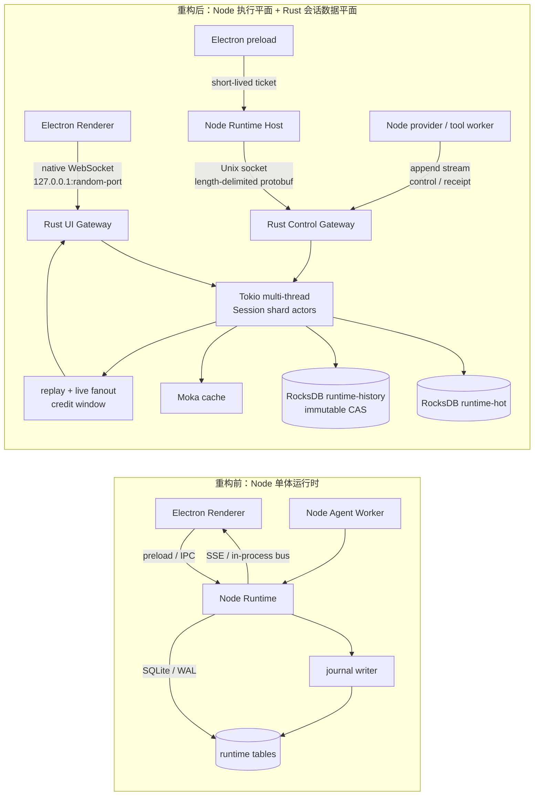

# Agent Runtime Rust 重构：架构与 IPC 拓扑

日期：2026-10-16

## 一张图

## IPC 拓扑

| 链路 | 传输 | 调用方 | 权威职责 | 恢复语义 |
|---|---|---|---|---|
| Renderer → Rust UI Gateway | 原生 WebSocket，随机本地 TCP 端口 | Electron Renderer | snapshot、cursor replay、live event、credit | ticket 过期、cursor resume、`RESYNC_REQUIRED` |
| Node Host → Rust Control Gateway | Unix domain socket；Windows 目标为 Named Pipe | Node RuntimeFacade、provider worker | admission、stream append、permission/interaction、stop/resume、history | request receipt、epoch/revision fence、同帧重试 |
| Rust actor → runtime-hot | Tokio blocking executor + RocksDB WriteBatch | Session shard actor | session/run/control/live projection | commit 与 receipt 同批；ack unknown 可查询 receipt |
| Rust actor → runtime-history | 独立 RocksDB + CAS object | history command | immutable object、head、pin、checkpoint、fork、GC | 内容寻址；head revision fence |

## 关键变化

| 维度 | 重构前 | 重构后 |
|---|---|---|
| 并发模型 | Node event loop + SQLite writer contention | Tokio multi-thread + session shard 串行化 |
| 会话权威状态 | SQLite 行、journal、内存 bus 多份状态 | Rust actor + RocksDB；Node 保留兼容 read model 直到迁移完成 |
| Electron 实时流 | preload 转发 Node/SSE | Renderer 原生 WebSocket 直连 Rust UI Gateway |
| 控制幂等 | 业务层局部处理 | request receipt + 内容指纹 + epoch/revision |
| 历史数据 | flat/versioned/JSONL 多模式 | runtime-history immutable CAS + head/pin |
| 慢消费者 | 进程内队列容易堆积 | event/byte credit window，超限重同步 |

## 当前边界

Rust authoritative runtime-hot、control、history CAS、migration CLI 已有真实 smoke；terminal run 完成会镜像 run/message/tool call，Windows Named Pipe 已接入 Tokio transport 代码但尚未在 Windows 目标机验收。旧 SQLite session/run/message 线上 read model、provider 全链路切换和旧 journal/legacy history 删除仍需继续推进。
