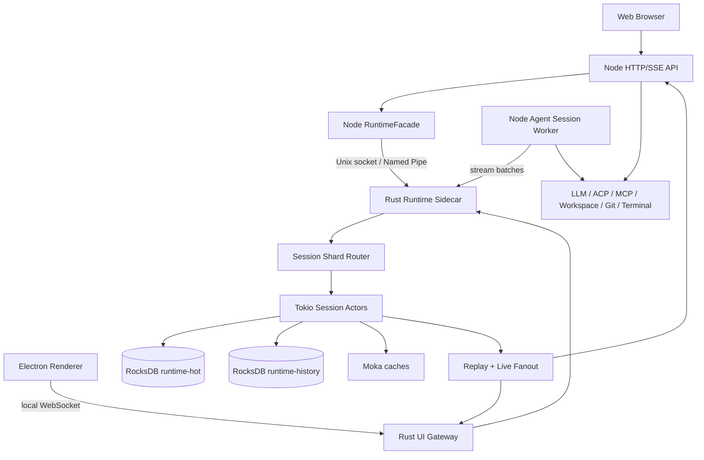

# Agent Runtime Rust Sidecar 设计

日期：2026-10-16

基线：`origin/main` / `22ed239a8939ae66bfd2fee650de16057521de1d`

状态：设计冻结候选，分阶段实施中

## 1. 目标

将现有 Node.js agent runtime 重构为 Node 执行平面 + Rust 会话数据平面的 sidecar 架构，重点解决：

- 多 session 并发时 SQLite 写锁和 Node 事件循环阻塞；
- 流式事件、session 状态、run admission、权限/交互恢复之间的多套状态来源；
- session replay、SSE、live bus、session log 的双重游标和跨进程转发；
- checkpoint/history 与在线运行状态混在同一个存储边界中；
- Electron 桌面端无法直接使用高吞吐本地会话数据通道。

原有功能目标需要保持：

- session 创建、列表、归档、恢复、删除；
- run admission、幂等 request、cancel、resume、recovery；
- 多轮流式输出和断线重连；
- permission、interaction、input queue；
- subagent session tree；
- message、run、step、part、tool call、usage、artifact 审计；
- checkpoint、fork、rollback、history visit；
- workspace、Git、terminal、MCP、ACP、browser 和 LLM provider 集成。

允许彻底删除旧的 SQLite runtime 实现、storage owner、journal writer、旧 JSONL replay 和多套 history mode。SQLite 只保留为一次性离线导入源，不能作为新 runtime 的线上 fallback。

## 2. 当前基线摸排

最新 HEAD 的关键规模：

- 66 个数据库迁移文件；
- 迁移中约 79 张表；
- agent runtime HTTP 路由约 95 个；
- agent runtime 测试文件约 164 个；
- `session-store.ts` 约 2484 行；
- `loop-runtime.ts` 约 3734 行；
- runtime 模块中存在大量直接 SQLite 访问；
- 仓库当前没有 Rust workspace 或 Cargo 工程。

现有入口和边界：

- Node API 和 runtime host：`services/local-node/entrypoints/http-server.ts`；
- SQLite/WAL/迁移：`services/local-node/infrastructure/database/index.ts`；
- runtime session/run/message/store：`services/local-node/modules/agent-runtime/session-store.ts`；
- run admission：`services/local-node/modules/agent-runtime/run-admission.ts`；
- run orchestration：`services/local-node/modules/agent-runtime/run-coordinator.ts`；
- stream replay：`services/local-node/modules/agent-runtime/runtime-journal.ts`；
- session child process：`services/local-node/modules/agent-runtime/session-process-manager.ts`；
- Electron API sidecar：`electron/lib/node-sidecar.ts`；
- 前端 stream projection：`client/src/adapters/transport/runtimeStream.ts` 和 `client/src/adapters/transport/sessionLive.ts`。

现有执行平面继续由 Node 负责。Rust sidecar 不直接执行 LLM、MCP、ACP、workspace、Git、terminal 或 browser 工具。

## 3. 总体架构



### 3.1 传输层

Rust sidecar 同时提供两种内部传输：

1. UI WebSocket：绑定 `127.0.0.1:0`，供 Electron renderer 使用原生 WebSocket API；
2. runtime IPC：Unix 使用 `tokio::net::UnixListener`，Windows 使用 Named Pipe 或本地 TCP fallback，供 Node Runtime Host 和 Node worker 使用。

Web 部署不直接暴露 Rust sidecar 端口，继续由 Node API 提供 HTTP/SSE 或 WebSocket proxy。

所有连接都使用 protobuf binary envelope：

```text
Envelope {
  protocol_version
  request_id
  stream_id
  session_id
  run_id
  epoch
  revision
  sequence
  producer_id
  producer_sequence
  body
}
```

WebSocket 连接必须先完成短期 ticket authentication。ticket 绑定 client、过期时间、允许的 session 和 operation。随机端口只用于避免端口冲突，不作为安全边界。

### 当前桌面接入（2026-10-16，过渡阶段）

```text
Renderer → preload IPC（可信 frame 校验）→ Node /runtime-ticket
                                               ↓ 私有 Unix socket：IssueTicket
Renderer ← preload ← 短期 ticket + 随机端口 URL ← Rust TicketStore

Renderer ⇄ ws://127.0.0.1:<随机端口>/runtime ⇄ Rust UI Gateway
  → Hello(ticket, client_id) → UiSnapshot → Subscribe(session_id, persisted_cursor)
  ← UiSnapshotResponse(完整持久化状态) → Snapshot(cursor 高水位) → backlog → live events
  → Credit(through_sequence)，仅在应用事件后发送
```

当前实现的 ticket 30 秒失效、单次使用、限定 client/session 和只读订阅操作；私有服务凭据不发给 Renderer。信用窗口为 64 个事件 / 2 MiB，积压无法连续交付时发送 `RESYNC_REQUIRED` 并完成有时限的关闭握手。Renderer 也识别 close reason，避免终止错误帧丢失时停留在错误游标。

Node 与 Renderer 共享浏览器安全的 protobuf codec。事件 payload 带 `schema:1` 及提交时状态，不能在 replay 时从 SQL 读取当前状态替代历史状态。RocksDB 的 `ui_projections` 与 session/run/event/receipt 在同一 WriteBatch 更新。Renderer 初次认证后发送 `ui_snapshot`，收到完整物化快照才从该 cursor 订阅，Node ticket 不再携带 snapshot；Web compatibility facade 同样读取 Rust projection。当前 step 的 delta 合并存储，不因热事件保留窗而丢失较早文本。

**尚未满足最终架构的部分**：首次创建 projection 仍通过 Node session 元数据 seed；seed 是 create-if-absent 且仅接受没有旧执行的会话，旧会话需要离线迁移。session 元数据修改、permission/input/stop/resume 等写路径仍待 repository 迁移，媒体和手动压缩事件仍在 Node 的独立辅助流。projection 暂限 768 KiB，超出拒绝整批提交，不做截断；大内容 blob/CAS、默认启用、完整 history、旧实现删除和真实压测未完成。

### 3.2 Tokio 并发模型

- Tokio multi-thread runtime 负责 RPC、session actor、fanout 和维护任务；
- RocksDB 长耗时 iterator、批量导入、GC、checkpoint export 进入受限 blocking executor；
- session 按 `hash(session_id) % shard_count` 路由到 shard mailbox；
- 同一 session 的 command 串行，不同 session 并行；
- 每个 shard 和连接均有 bounded queue；
- 任何队列超过阈值必须返回 `BACKPRESSURE`，不能无限积压。

核心 fencing 字段：

```text
session_id
session_epoch
expected_revision
request_id
producer_id
producer_sequence
```

旧 worker、旧进程、重试请求和过期历史分支都必须通过 epoch/revision/request receipt 校验。

## 4. RocksDB 存储设计

使用两个 RocksDB 实例，隔离在线热点和历史维护。

### 4.1 runtime-hot

Column Families：

```text
session
run
step
stream
interaction
permission
input_queue
idempotency
lease
process_ownership
outbox
metadata
```

一次 run admission 使用一个 WriteBatch 原子提交：

```text
idempotency receipt
run
session active_run/status
run_started event
initial cursor
```

### 4.2 runtime-history

Column Families：

```text
messages
run_parts
runtime_events
tool_calls
artifacts
history_heads
history_objects
history_edges
checkpoints
pins
history_indexes
gc_marks
```

历史对象采用内容寻址：

```text
object/{sha256}
edge/{source_hash}/{target_hash}
head/{session_id}
pin/{session_id}/{version_id}
```

大文件、媒体和工具完整输出继续使用文件 CAS，RocksDB 只保存 metadata 和引用关系。

### 4.3 事件持久化等级

```text
sync:
  user message
  tool result
  permission
  interaction
  run completed/failed

group_commit:
  step started
  message delta
  thought delta
  retry status

ephemeral:
  heartbeat
  duplicate UI state
  transient progress
```

UI delta 不再作为长期 canonical transcript 保存。run 完成时写入完整 assistant message、tool result 和 canonical runtime event。

## 5. Moka 缓存

使用 `moka::future::Cache`，不在缓存外重复套全局 Mutex。

缓存范围：

```text
SessionSnapshotCache
ActiveRunCache
PendingControlCache
HistoryPageCache
SessionTreeIndexCache
```

缓存 key 必须包含 `epoch` 和 `revision`。写入顺序固定为：

```text
RocksDB commit
invalidate/update cache
publish event
```

缓存不是权威来源，任何 cache miss 都可以回到 RocksDB 重建。

## 6. 统一 runtime 协议

内部 command：

```text
CreateSession
AdmitRun
AppendStreamBatch
FinalizeRun
GetSessionSnapshot
SubscribeSession
BeginStop
AcknowledgeStop
ReplyPermission
ReplyInteraction
QueueInput
RemoveQueuedInput
ArchiveSession
RestoreSession
ForkHistory
SwitchHistoryHead
```

错误码：

```text
STALE_EPOCH
REVISION_CONFLICT
REQUEST_CONFLICT
SESSION_BUSY
CURSOR_EXPIRED
BACKPRESSURE
RECOVERY_REQUIRED
STORAGE_UNAVAILABLE
DURABILITY_UNKNOWN
INVALID_STATE
```

订阅协议必须支持：

```text
snapshot_then_live
replay_after_cursor
window_update
ack
resync_required
```

由于浏览器 WebSocket API 没有应用层 backpressure，服务端必须按 event 数量和 byte 数量维护信用窗口。窗口耗尽时只保留 canonical event，并允许合并 delta；无法保持连续回放时发送 `RESYNC_REQUIRED`。

### 6.4 执行恢复与幂等边界

Rust sidecar 的 supervisor 在每次启动都等待 `READY` 和 Unix control health；socket path、token 和 RocksDB hot path 在同一 Node owner 生命周期内稳定，sidecar 重启只更换随机 TCP 端口。Node 的 append 请求带稳定 `request_id`，Rust 用版本化 SHA-256 指纹持久化 `(session, run, producer, producer_sequence, epoch, durability, events)` receipt。相同请求在提交后响应丢失时返回原 receipt，不能重新写 event 或重复 fanout；同一 producer sequence 的 payload 改变返回 `REQUEST_CONFLICT`。

control transport 为每连接 32 个任务、全局 128 个任务、8 MiB 响应预算；慢请求不能阻塞快请求，shutdown 等待已接受任务有界排空。关闭或父进程死亡会清理子进程和 Unix socket；客户端在 transport error 或 durability unknown 时只用同一 request frame 重试，并受总 deadline 限制。

## 7. Node 侧职责调整

新增：

```text
services/local-node/modules/agent-runtime/sidecar/
  sidecar-client.ts
  sidecar-protocol.ts
  sidecar-runtime-repository.ts
  sidecar-stream-client.ts
  sidecar-recovery.ts
  sidecar-health.ts
```

逐步重构：

- `session-store.ts` 拆成 repository facade，不再直接持有 SQLite 业务逻辑；
- `run-coordinator.ts` 调用 sidecar admission、stop、resume、finalize；
- `runtime-stream-writer.ts` 直接提交 batch；
- `runtime-journal.ts` 变为 cursor/replay 兼容 facade；
- `event-service.ts` 和 `interaction-service.ts` 改为 sidecar command；
- `session-process-manager.ts` 继续管理真实 Node child 和 PID，但 lease 写入 sidecar；
- `agent-runtime.ts` 保持现有对外 HTTP 路由，路由内部调用 RuntimeFacade；
- `client/src/adapters/transport/sessionLive.ts` 增加 WebSocket transport，Web 模式继续使用 SSE fallback。

## 8. 数据迁移

不做长期双写，不保留 SQLite 线上 fallback。

新增离线命令：

```text
synax-runtime-migrate export
synax-runtime-migrate import
synax-runtime-migrate verify
synax-runtime-migrate rebuild-index
```

迁移时停止旧 runtime，读取 SQLite、旧 session log、checkpoint/history 数据，统一转换成新对象模型。无法转换的 session 进入 quarantine report。迁移完成后校验 session、run、step、message、interaction、permission、history head、checkpoint、cursor 和 active execution 状态。

## 9. 故障语义

必须覆盖：

- WAL commit 后 response 前 sidecar 崩溃；
- Node worker 发送后断开；
- request receipt 查询和安全重试；
- 旧 epoch worker 继续发消息；
- WebSocket 客户端慢消费；
- sidecar 重启后 snapshot/replay；
- RocksDB compaction 期间 append；
- 磁盘空间不足；
- session stop 进入 unconfirmed；
- sidecar 与 Node 版本不兼容。

未知提交结果统一返回或内部记录 `DURABILITY_UNKNOWN`，调用方必须通过 request receipt 查询，禁止盲目重放。

## 10. 性能目标

这些是阶段验收目标，不是未测试的承诺：

| 指标 | 目标 |
|---|---:|
| warm session snapshot p99 | ≤ 2ms |
| RocksDB session miss p99 | ≤ 8ms |
| run admission p99 | ≤ 15ms |
| canonical state commit p99 | ≤ 20ms |
| 4KB stream batch append p99 | ≤ 10ms |
| UI live fanout lag | ≤ 50ms |
| 1000 session recovery | ≤ 30s |
| duplicate commit after retry | 0 |
| stale epoch write success | 0 |

压测必须覆盖 100、500、1000、5000 active sessions，以及 1KB、4KB、16KB event batch；必须注入 WAL、ack、socket、compaction、ENOSPC 和慢消费者故障。

## 11. 非目标

第一阶段不迁移：

- LLM provider 实现；
- MCP、ACP、browser、terminal、Git、workspace 工具；
- project/config/skills 存储；
- 所有前端页面；
- 真实用户数据自动在线迁移。

这些能力通过 Node RuntimeFacade 继续工作。
