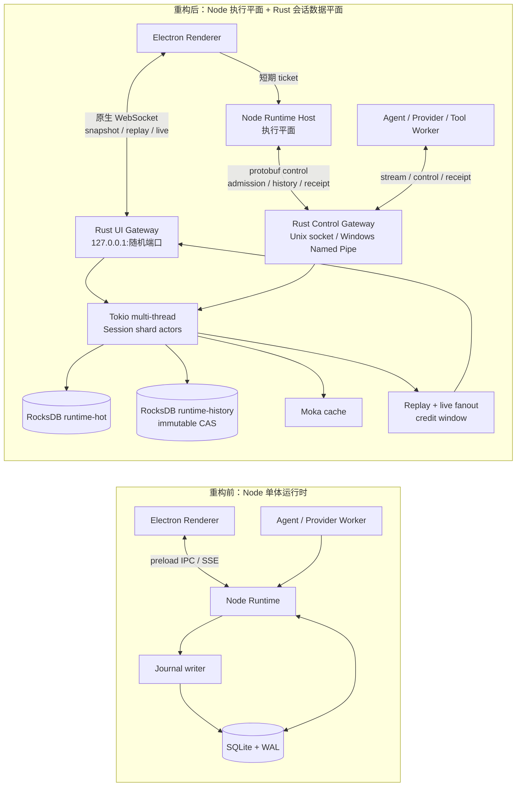

# Agent Runtime Rust 重构：架构差异与 IPC 拓扑

日期：2026-10-17

这是当前 `codex/agent-runtime-rust-sidecar` 分支的阶段性架构汇报。Rust 已经承接 runtime-hot、control、history 和 Electron 实时订阅；Node 仍负责执行平面，并保留部分 SQLite 兼容读模型，后续继续删除。

## 一张图

## IPC 拓扑

| 链路 | 当前传输 | 主要内容 | 关键语义 |
|---|---|---|---|
| Renderer → Node | Electron preload IPC / 本地 runtime-ticket HTTP | 请求会话订阅票据 | 校验 frame、client、session；票据短期有效、单次使用 |
| Renderer ⇄ Rust UI Gateway | 原生 WebSocket，`127.0.0.1:<随机端口>/runtime` | snapshot、cursor replay、live event、credit | 断线按 cursor 恢复；窗口耗尽时返回 `RESYNC_REQUIRED` |
| Node Host ⇄ Rust Control Gateway | Unix domain socket；Windows 为 Named Pipe；protobuf envelope | admission、stream append、receipt、permission、interaction、stop/resume、history | request receipt、epoch/revision fence、同帧安全重试 |
| Provider / Tool Worker ⇄ Rust | 同一 Control Gateway | 流式输出、工具结果、terminal finish | worker 重启或重复发送不会重复提交 canonical event |
| Rust actor → 存储 | Tokio 调度 + 受限 blocking RocksDB 操作 | session/run/control/event/projection/history | WriteBatch 原子提交；cache 只做加速，不是权威来源 |

## 差异汇报

| 维度 | 重构前 | 重构后 |
|---|---|---|
| 会话权威状态 | Node 内存、SQLite 行、journal、SSE bus 多份状态 | Rust session actor + RocksDB；Node 保留兼容边界 |
| 并发模型 | Node event loop 与 SQLite writer contention | Tokio multi-thread；同一 session 串行，不同 session 并行 |
| Electron 实时流 | preload 转发 Node/SSE | Renderer 原生 WebSocket 直连 Rust UI Gateway |
| 控制幂等 | 业务层分散处理 | receipt + 内容指纹 + epoch/revision fencing |
| 历史模型 | flat/versioned/JSONL 与在线状态耦合 | 独立 runtime-history、immutable CAS、head/pin/checkpoint |
| 慢消费者 | 进程内队列容易持续堆积 | event/byte credit window；无法连续交付时要求重同步 |
| 失败恢复 | 重试可能重新写入或依赖内存状态 | `DURABILITY_UNKNOWN` 可查 receipt；sidecar 重启后 cursor/replay 恢复 |

## 当前边界

- 已落地：Tokio multi-thread、session shard、RocksDB hot/history、Moka、Rust control、Electron WebSocket、Unix socket、Windows Named Pipe 代码路径、迁移与故障 smoke；runtime-history 增加内容寻址的分块 blob/manifest 校验。
- 仍在收口：Node SQLite session/run/message 兼容镜像、旧 checkpoint/history mode、完整 recovery authority、完整 history part/media API、Windows 目标机实际执行验收，以及真实外部 provider 凭证验收。
- 数据权威方向：新 authoritative host 由 Rust 管理 runtime-hot、control、history；产品 host 已移除 legacy 环境开关，旧同步路径只作为测试 fixture 的显式 disabled transport 保留，彻底删除安排在离线迁移与 purge 验收之后。
