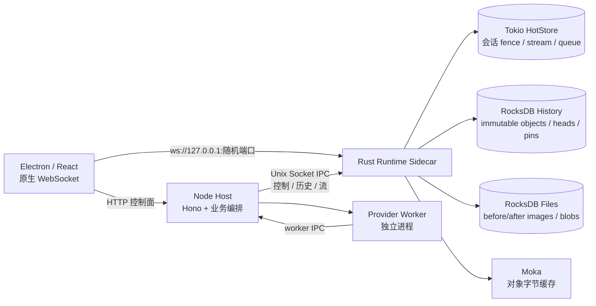
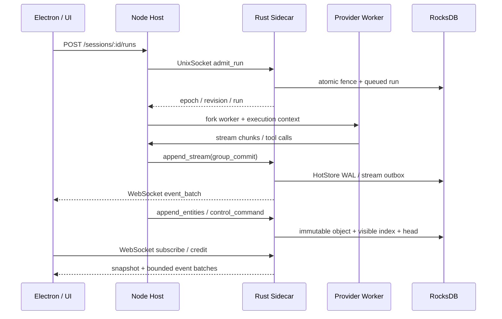

# Synax Runtime 2.0：Rust Sidecar 全新安装方案

日期：2026-10-18
版本：2.0.0
状态：2.0.0 硬切换主线已完成并通过验证

## 决策

2.0.0 采用硬切换。旧 runtime 数据不迁移，旧 SQLite runtime 表、flat history、JSONL transcript、旧 checkpoint/version-store、旧 mutation journal 均不作为启动输入，也不再提供在线兼容路径。用户安装 2.0.0 后，runtime 从空的 RocksDB 目录开始；旧 `context.db` 可以保留给其他应用配置，但 runtime 不读取其中的历史表。

应用保留的行为目标：会话创建、消息和运行记录、流式增量、provider worker、工具调用、权限、交互、队列、文件写入前后镜像、checkpoint、回滚、fork、资产和重启恢复。

## 目标架构



Node 负责 HTTP、provider 适配、工具编排和 Electron 集成。Rust 是 runtime 的唯一持久化权威：Tokio 多线程 runtime 负责并发连接和 session shard，HotStore 保存当前运行 fence 与有界流窗口，RocksDB 保存不可变历史、控制事件、文件镜像、资产 blob，Moka 只做可淘汰缓存。Node working set 只在执行边界加载，并通过显式 flush 提交。

## IPC 拓扑



每个 session 的写入按 Rust fence 串行化；不同 session 通过 shard 并行。WebSocket 只传增量和当前快照，历史列表使用带 cursor 的字节分页。IPC payload 受 768 KiB 左右预算约束，单个超大实体必须走 blob 或分块接口。

## 数据布局

- `runtime-sidecar/runtime-hot`：HotStore，当前 session state、active run、epoch、revision、queue、control 和可重放 stream。
- `runtime-sidecar/runtime-history`：RocksDB immutable objects、heads、pins、visible entity indexes、outbox、asset metadata、asset bindings、blob chunks、file operations。
- `runtime-media/`：本地文件副本，用于需要本地路径的 provider；内容哈希和元数据以 Rust asset/blob 为准。
- `context.db`：仅供配置、项目和其他非 runtime 领域使用；2.0 runtime 不创建、不查询、不写入旧 `agent_runtime_*`、`conversation_*`、`jsonl_*`、`transcript_*` 表。

## 在线写入规则

1. 新 session 先由 Rust `seed_session` 建立 projection，再进入 Node working set。
2. 新 run 先由 Rust `admit_run` 建立 request identity、epoch 和 queued run；Node 只有在 Rust 成功后才启动 worker。
3. 流事件先进入 HotStore，终态和可见实体通过 Rust history append/reconcile 发布。
4. permission 和 interaction 的未解决状态留在 HotStore；已完成状态写入 durable outbox，再进入 immutable history。
5. 文件操作由 Rust 保存 before/after image、权限位、symlink 和 Git 保护信息；恢复时按 checkpoint head 做 CAS 检查。
6. checkpoint、rollback、fork 只操作 Rust head/pin/file image，不复制整段会话。
7. Node 读取历史必须使用 Rust 分页；禁止整图扫描和旧 SQL fallback。

## 已完成的主路径

- Tokio 多线程 sidecar、Unix Socket、随机本地 WebSocket 端口和 ticket 鉴权。
- RocksDB history、head、pin、visible index、outbox、blob、文件 image。
- Moka 字节权重缓存，当前容量 64 MiB。
- Rust-backed Node working set，session/run/message/step/part/tool/event/work/context/usage/control 均显式 hydrate/flush。
- provider worker、`file.read`、`file.write`、permission、interaction、Terminal PTY、WebSocket 增量、host restart。
- checkpoint preview、文件回滚、历史 head 切换、旧 epoch 请求失效和恢复后继续执行。
- 删除在线 flat/transcript/version-store/checkpoint SQL 实现、旧进程/Terminal SQL fallback 及旧数据迁移 CLI；新安装不做历史迁移。

## 阶段与验收目标

### 阶段 0：硬切换边界

完成旧 runtime 文件和迁移脚本删除，清理 package script、在线 import 和旧测试。验收标准是 `rg` 不再找到在线 runtime 对旧 checkpoint/transcript/version-store 的引用，`npm run typecheck` 通过。

### 阶段 1：新安装生命周期

使用空临时 DATA_ROOT 启动 Node Host 和 Rust sidecar，创建 session，写入一轮消息，结束进程，再启动并读回。验收 Rust HotStore/RocksDB 可重启恢复，且没有旧 runtime SQL 表或旧表 SQL 探针记录。

### 阶段 2：执行与 IPC

验证 HTTP admission → provider worker → Rust stream/history → WebSocket subscription → host restart → 第二轮执行。验收 request identity、epoch、revision、增量序列和终态一致。

### 阶段 3：文件和历史

验证 file read/write、before/after image、手动修改冲突、Git 提交保护、checkpoint preview、rollback、fork 和恢复后新一轮执行。验收文件内容、权限、symlink、历史 head 和旧 request 失效。

### 阶段 4：控制状态和资产

验证 permission、interaction、队列、取消、重启恢复、asset metadata/blob/binding。验收热状态只保留未解决控制项，完整历史可分页读回，资产删除受到 Rust binding 保护。

### 阶段 5：发布包

运行 Rust test、TypeScript typecheck、定向 Vitest、空目录 E2E，再执行 `npm run make:desktop` 生成 2.0.0 DMG。DMG 验收使用新的临时 DATA_ROOT，不导入或依赖当前用户旧目录。

## 验证命令

```sh
npm run runtime-sidecar:test -- --locked
npm run typecheck
./node_modules/.bin/tsc -b client/tsconfig.json
node --import tsx/esm scripts/runtime-v2-files-smoke.ts
node --import tsx/esm scripts/runtime-v2-interaction-smoke.ts
node --import tsx/esm scripts/runtime-v2-main-path-e2e.ts
npm run make:desktop
```

最终发布条件：上述检查全部通过；Rust Terminal smoke 和空目录 E2E 均通过；空目录 E2E 报告 `no old runtime SQL tables` 和 `no retired SQL reads or writes`；DMG 中包含 release Rust sidecar，启动后可以通过 HTTP 和原生 WebSocket 完成最小会话闭环。
