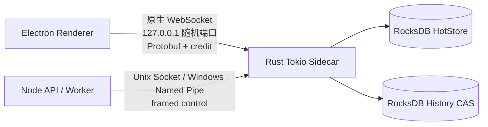

# Agent Runtime Rust Sidecar 当前 HEAD 验收记录

日期：2026-10-17  
分支：`codex/agent-runtime-rust-sidecar`  
HEAD：`4fb20748`  
版本：`1.26.3`

## 已完成的开发节点

- `76bba59b`：RocksDB history 增量 GC、可恢复 page cursor。
- `b3d1ab2e`：durable history outbox watermark、有限清理和重启恢复。
- `4faf6709`：authoritative terminal Rust hydration/socket replay。
- `cc4cd1c5`：authoritative execution context Rust async fence。
- `b22e3eb7`：旧 flat/versioned/JSONL/checkpoint 依赖隔离到非 authoritative 分支。
- `44e1717d`：外部 provider 验收 harness。
- `45018741`：测试 fixture 通过共享 session store 初始化 history，移除会复制 SQLite 连接的 CJS loader 路径。
- `e1da2c57`：Tokio 后台 history outbox maintenance 和 control command。
- `4680d845`：活跃 PTY 有界输出写入 Rust、HTTP lazy hydration、sidecar 重启恢复。
- `daf5d227`：outbox 后台维护改为直接扫描 RocksDB keyspace，覆盖无 UI projection 的旧 session。
- `4fb20748`：fresh/versioned history 初始化幂等化。

## 当前 IPC 拓扑

Rust sidecar 使用 Tokio multi-thread runtime；热点快照、ticket 和 projection 使用 Moka；durable stream 通过 RocksDB WriteBatch 同批写入 hot state、projection 和 history outbox。

## 当前验证证据

- 全量 Vitest：371 个测试文件，3000 个用例，2999 通过，1 跳过，0 失败。
- `npm run typecheck`：通过。
- `npm run runtime-sidecar:check`：通过。
- `npm run runtime-sidecar:test -- --locked`：73/73 通过。
- outbox maintenance smoke：通过，覆盖 bounded cleanup、duplicate reconcile、unknown ack restart recovery、background drain，以及无 UI projection keyspace scan。
- terminal smoke：通过，覆盖活跃 PTY 输出持久化、sidecar 重启、PTY 保持运行、Rust history metadata/output 恢复。
- terminal focused suite：18/18 通过。
- authoritative history boundary/flat/execution suite：37/37 通过。
- desktop unit suite：45/45 通过。
- `npm run make:desktop`：通过，生成 arm64 DMG 和 ZIP。

## 当前 DMG

- 文件：[Synax-1.26.3-darwin-arm64.dmg](/Users/mint/.codex/worktrees/3da8/Synax/out/make/Synax-1.26.3-darwin-arm64.dmg)
- 大小：285,271,598 bytes
- SHA-256：`acb1b0a5d509df74e28cd8d29d8a17e85178471b737547e6098f4ffbeb973c2a`
- 已通过 `hdiutil attach` 挂载检查，DMG 内含 `Synax.app`、安装说明和安装后运行脚本，随后已正常 eject。

## 尚未达到全量目标的边界

当前 authoritative stream/control/history/terminal 关键路径已由 Rust 承载，但仍有后续工作不能从上述证据推导完成：

- session/run/step/tool 的全部业务读写仍有 SQLite 兼容 repository，需要完成无 runtime SQL 表的完整业务路径验收。
- checkpoint workspace 文件恢复、fork/rollback 的 Rust 等价实现仍需独立验收。
- history 详情实体和部分全量 list API 仍需统一迁移到有界 graph cursor，并补长会话内存/延迟证据。
- durable outbox 的长期 GC、双故障恢复和旧数据库迁移仍需验收。
- 真实外部 provider smoke 需要配置 `SYNAX_EXTERNAL_PROVIDER_BASE_URL`、`SYNAX_EXTERNAL_PROVIDER_API_KEY`、`SYNAX_EXTERNAL_PROVIDER_MODEL`；当前环境没有这些凭证，因此没有伪造通过证据。
- 当前 HEAD 的四平台 workflow 仍需重新触发并保存结果；已有 workflow 证据对应更早代码线。

这些边界不影响本记录中的本地开发、全量回归和 arm64 DMG 试用结论，但在关闭前不能将全量 Rust authority migration 标为完成。
